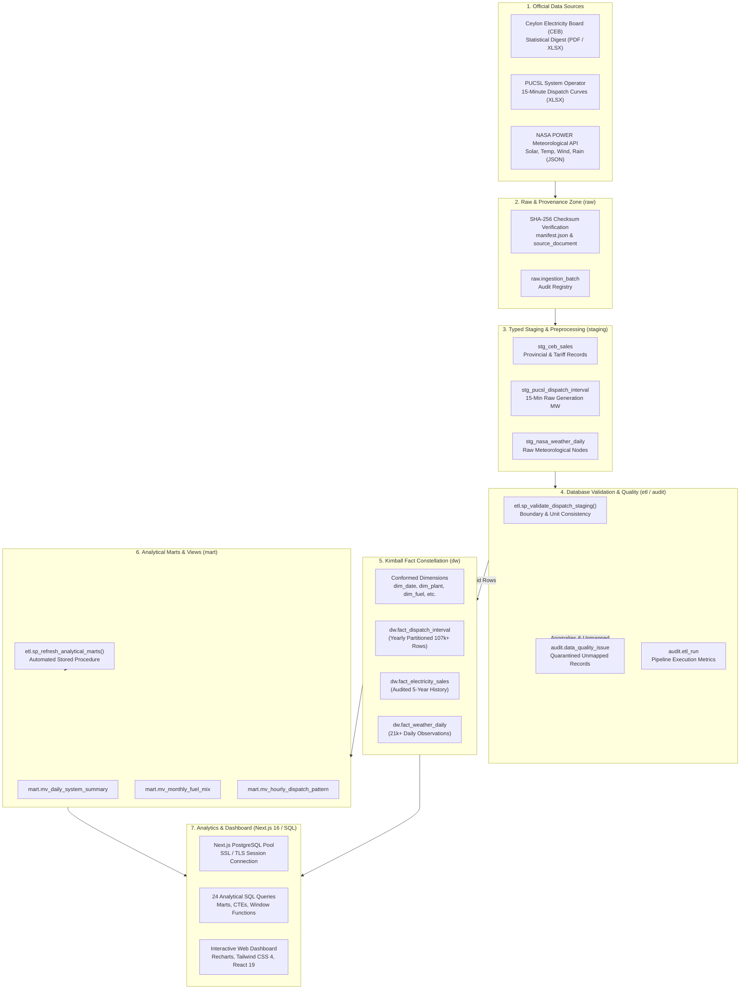

# End-to-End Data Pipeline & Architectural Flow

## Overview

The GridLens data warehouse operates an automated, idempotent multi-stage ELT pipeline designed to ingest, validate, conform, and expose electricity grid and meteorological data.

---

## Architectural Pipeline Diagram

---

## Detailed Data Processing Stages

### Stage 1 — Acquisition & Cryptographic Provenance
- Incoming source files from CEB, PUCSL, and NASA POWER are deposited in `data/raw/` with immutable filenames.
- SHA-256 cryptographic hashes are calculated immediately and checked against `data/raw/manifest.json`.
- Files are registered in `raw.source_document` with ingestion timestamps and reporting periods.

### Stage 2 — Staging & Format Normalization
- Parsers (`src/ingestion/`) convert PDFs, Excel sheets, and JSON streams into typed tabular records.
- Staging tables (`staging.stg_*`) preserve all original extracted strings alongside cast numeric equivalents to enable full auditability without silent drops.

### Stage 3 — Validation & Quarantine Defense
- Stored procedures (`etl.sp_validate_*`) execute validation checks:
  - Range boundaries ($MW \ge 0$, Solar Irradiance $\ge 0$).
  - Station name and alias resolution against `ref.plant_alias`.
  - Non-conforming or negative telemetry records are quarantined in `audit.data_quality_issue` with explicit error codes, while clean records advance into the warehouse.

### Stage 4 — Warehouse Transformation & Fact Loading
- Valid records are merged into conformed dimensions and fact tables using idempotent `ON CONFLICT DO UPDATE` or staging-partition swaps.
- High-volume facts (`fact_dispatch_interval`) route automatically to their respective yearly child partition based on UTC timestamp.

### Stage 5 — Analytical Mart Refresh
- `CALL etl.sp_refresh_analytical_marts();` refreshes pre-aggregated materialized views (`mart.mv_*`) concurrently where applicable, ensuring ultra-fast sub-second analytics.

### Stage 6 — Read-Only Dashboard Analytics
- The Next.js 16 full-stack web application connects over TLS/SSL using a dedicated read-only role or Supabase connection string.
- Analytical queries run with strict statement timeouts (5s to 10s) and leverage pre-aggregated marts and window functions.

