# Kimball Fact Constellation Architecture

## Dimensional Bus Matrix

The GridLens data warehouse adheres strictly to Ralph Kimball's dimensional bus architecture. Nine conformed dimensions intersect across six distinct business process facts.

| Business Process Fact Table | `dim_date` | `dim_interval` | `dim_source_system` | `dim_energy_source` | `dim_region` | `dim_consumption_sector` | `dim_power_plant` | `dim_weather_location` | `dim_metric` |
| :--- | :---: | :---: | :---: | :---: | :---: | :---: | :---: | :---: | :---: |
| **`fact_dispatch_interval`** | **X** | **X** | **X** | **X** | | | **X** | | |
| **`fact_generation_period`** | **X** | | **X** | **X** | | | **X** | | |
| **`fact_capacity_period`** | **X** | | **X** | **X** | | | **X** | | |
| **`fact_electricity_sales`** | **X** | | **X** | | **X** | **X** | | | |
| **`fact_weather_daily`** | **X** | | **X** | | | | | **X** | |
| **`fact_published_metric`** | **X** | | **X** | | **X** | | | | **X** |

---

## Fact Constellation Architecture Diagram

```mermaid
graph TD
    classDef dim fill:#1e293b,stroke:#3b82f6,stroke-width:2px,color:#f8fafc;
    classDef fact fill:#0f172a,stroke:#10b981,stroke-width:2px,color:#f8fafc;
    classDef mart fill:#312e81,stroke:#8b5cf6,stroke-width:2px,color:#f8fafc;

    %% Conformed Dimensions
    D_DATE["dim_date<br/>(date_key)"]:::dim
    D_INT["dim_interval<br/>(interval_key)"]:::dim
    D_SRC["dim_source_system<br/>(source_system_key)"]:::dim
    D_NRG["dim_energy_source<br/>(energy_source_key)"]:::dim
    D_REG["dim_region<br/>(region_key)"]:::dim
    D_SEC["dim_consumption_sector<br/>(sector_key)"]:::dim
    D_PLANT["dim_power_plant<br/>(power_plant_key, SCD2)"]:::dim
    D_WTH["dim_weather_location<br/>(weather_location_key)"]:::dim
    D_MET["dim_metric<br/>(metric_key)"]:::dim

    %% Fact Tables
    F_DISPATCH["dw.fact_dispatch_interval<br/>(15-Minute SCADA Telemetry)"]:::fact
    F_GEN["dw.fact_generation_period<br/>(Periodic Plant Generation)"]:::fact
    F_CAP["dw.fact_capacity_period<br/>(Dependable & Peak Capacity)"]:::fact
    F_SALES["dw.fact_electricity_sales<br/>(Provincial & Tariff Sales)"]:::fact
    F_WEATHER["dw.fact_weather_daily<br/>(NASA Solar & Weather)"]:::fact
    F_METRIC["dw.fact_published_metric<br/>(System Macro KPIs)"]:::fact

    %% Analytical Marts
    M_MONTH_GEN["mart.mv_monthly_generation_summary"]:::mart
    M_ENERGY_MIX["mart.mv_annual_energy_mix"]:::mart
    M_SALES_SUM["mart.mv_monthly_sales_summary"]:::mart
    M_DISPATCH_SRC["mart.mv_daily_dispatch_by_source"]:::mart
    M_WTH_SUM["mart.mv_monthly_weather_summary"]:::mart

    %% Relationships: Dispatch
    D_DATE --> F_DISPATCH
    D_INT --> F_DISPATCH
    D_SRC --> F_DISPATCH
    D_NRG --> F_DISPATCH
    D_PLANT --> F_DISPATCH

    %% Relationships: Generation & Capacity
    D_DATE --> F_GEN
    D_SRC --> F_GEN
    D_NRG --> F_GEN
    D_PLANT --> F_GEN

    D_DATE --> F_CAP
    D_SRC --> F_CAP
    D_NRG --> F_CAP
    D_PLANT --> F_CAP

    %% Relationships: Sales
    D_DATE --> F_SALES
    D_SRC --> F_SALES
    D_REG --> F_SALES
    D_SEC --> F_SALES

    %% Relationships: Weather
    D_DATE --> F_WEATHER
    D_SRC --> F_WEATHER
    D_WTH --> F_WEATHER

    %% Relationships: Published Metrics
    D_DATE --> F_METRIC
    D_SRC --> F_METRIC
    D_REG --> F_METRIC
    D_MET --> F_METRIC

    %% Mart rollups
    F_GEN --> M_MONTH_GEN
    F_GEN --> M_ENERGY_MIX
    F_SALES --> M_SALES_SUM
    F_DISPATCH --> M_DISPATCH_SRC
    F_WEATHER --> M_WTH_SUM
```

---

## Architectural Principles

1. **Grain Isolation**: Every fact table records measurements at an immutable, uniform grain. Sub-daily 15-minute dispatch ($MW$) is never stored in the same table as monthly sales ($GWh$).
2. **Conformed Dimensions**: Shared attributes such as `dim_date`, `dim_energy_source`, `dim_power_plant`, and `dim_region` maintain single source-of-truth definitions across all facts, enabling cross-domain joins without bridge tables.
3. **Surrogate Keys**: Integer surrogate primary keys (`GENERATED ALWAYS AS IDENTITY`) isolate the analytical schema from changing natural keys in upstream utility systems.
4. **Physical Partitioning**: High-volume facts (`fact_dispatch_interval`) use declarative range partitioning by year to maximize query performance and partition pruning in PostgreSQL.
5. **Separation of Schemas**:
   - `raw`: Cryptographic provenance and unmutated payload ingestion.
   - `staging`: Typed transformation and boundary validation.
   - `ref`: Reference taxonomies and quality rules.
   - `dw`: Conformed facts and dimensions.
   - `mart`: Pre-aggregated materialized views and grain-safe query views.
   - `audit`: Data quality issues and ETL pipeline execution logs.
   - `etl`: Orchestration control and stored procedures.
