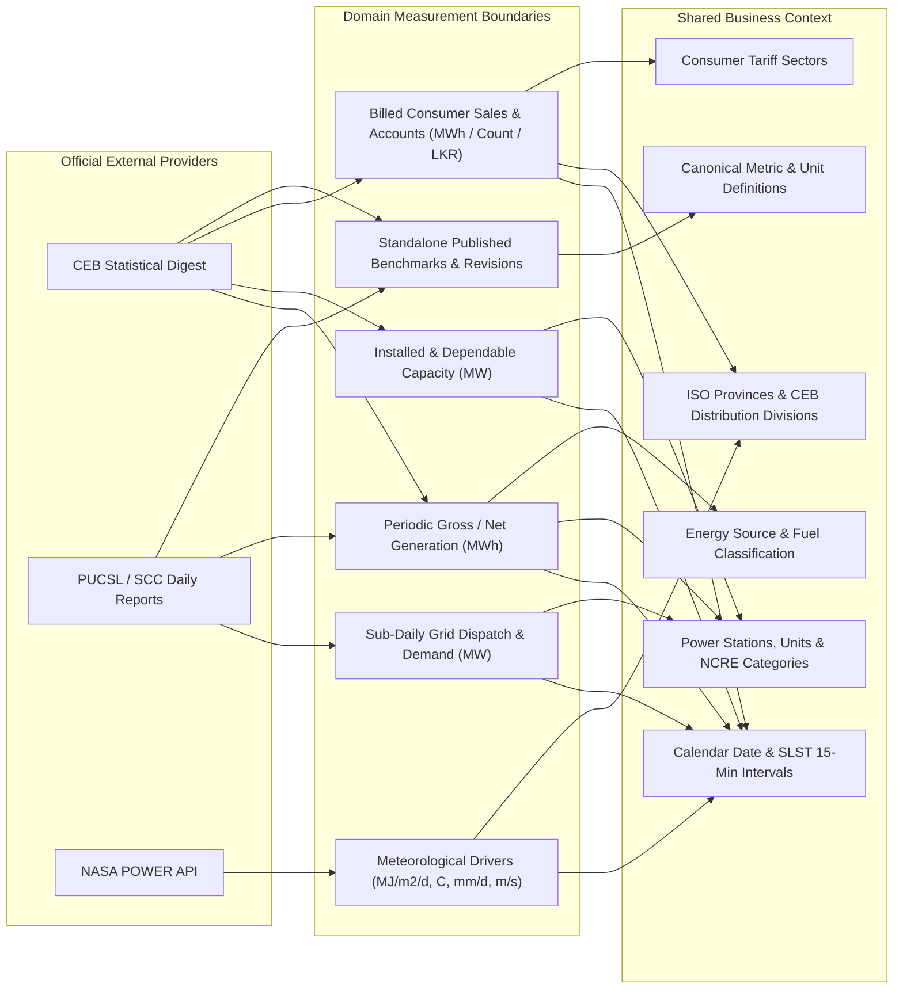

# System Architecture Overview — Sri Lanka National Electricity Grid Analytics Data Warehouse

## 1. Architectural Vision & Scope
The **National Electricity Grid Analytics Data Warehouse — Sri Lanka** is a centralized, provenance-aware analytical data warehouse engineered on **PostgreSQL 18** ([docker-compose.yml](file:///c:/Fullstack%20development%20course/Data%20Ware%20House%20Project/docker-compose.yml)). It models multi-source historical electricity generation, generation mix, sub-daily dispatch, installed/dependable capacity, billed electricity sales, and daily meteorological drivers across authentic Sri Lankan datasets:

1. **Ceylon Electricity Board (CEB)** — Statistical Digests and corporate monthly/annual summaries.
2. **Public Utilities Commission of Sri Lanka (PUCSL) / CEB System Control Centre** — Daily generation and 15-minute operational dispatch bulletins.
3. **NASA POWER Project** — Daily satellite/assimilation solar irradiance, temperature, precipitation, humidity, and wind speed observations.

---

## 2. Conceptual Data Model

At the conceptual level, the warehouse separates **distinct physical and economic concepts** so they are never treated as interchangeable:

### Strict Domain Distinctions Enforced
- **Power (`MW`) vs. Energy (`MWh` / `GWh`)**: Active power (`MW`) measures instantaneous generation or demand rate and is **never summed across time**. Energy (`MWh`, where $1\text{ GWh} = 1{,}000\text{ MWh}$) measures integrated electrical work over a time interval ($\text{MWh} = \text{MW} \times \Delta t_{\text{hours}}$).
- **Electricity Generation vs. System Demand vs. Electricity Sales**:
  - *Gross Generation*: Energy measured at generator terminals before station auxiliary consumption.
  - *Net Generation*: Energy sent out to the transmission grid after deducting station auxiliaries.
  - *System Demand (`MW`)*: Instantaneous grid load met at generation/transmission level.
  - *Electricity Sales (`MWh`)*: End-consumer metered and billed energy after transmission and distribution (T&D) losses.
- **Installed Capacity vs. Generation**: Nameplate/dependable capacity (`MW`) is semi-additive across distinct plants at a point in time, never additive across periods. Capacity factor is not stored blindly unless capacity and generation period hours/boundaries match.
- **Missing (`NULL`) vs. Zero (`0`)**: $0\text{ MW}$ / $0\text{ MWh}$ denotes a verified shutdown or zero solar output at night; missing/unreported observations (e.g., `-`, `N/A`, NASA `-999.0`) are stored strictly as `NULL`.
- **Reported vs. Estimated vs. Audited Values**: Tracked via `value_nature` and `dw.dim_metric` so provisional daily bulletins and audited annual digests remain distinguishable.

---

## 3. Multi-Schema Physical Architecture

Implemented in [001_bootstrap.sql](file:///c:/Fullstack%20development%20course/Data%20Ware%20House%20Project/database/migrations/001_bootstrap.sql) through [017_scheduler_metadata.sql](file:///c:/Fullstack%20development%20course/Data%20Ware%20House%20Project/database/migrations/017_scheduler_metadata.sql):

| Schema | Role in Architecture | Key Tables / Objects |
|---|---|---|
| `raw` | Source provider registry, immutable file provenance (`SHA-256`, exact URL, reporting period), extraction batches, and raw `JSONB` row payloads ([002_raw_source_registry.sql](file:///c:/Fullstack%20development%20course/Data%20Ware%20House%20Project/database/migrations/002_raw_source_registry.sql)). Raw files remain on disk under `data/raw/`. | `source_system`, `source_document`, `ingestion_batch`, `extracted_record` |
| `staging` | Typed pre-approval landing zone ([009_staging_tables.sql](file:///c:/Fullstack%20development%20course/Data%20Ware%20House%20Project/database/migrations/009_staging_tables.sql)). Retains raw text, parsed values, `raw_record_id`, and `validation_status` (`pending`, `valid`, `quarantined`, `loaded`). Never drops malformed rows. | `stg_dispatch_observation`, `stg_generation_report`, `stg_electricity_sales`, `stg_plant_capacity`, `stg_weather_observation`, `stg_published_statistic` |
| `ref` | Controlled units, deterministic conversion factors, reporting period types, evidence-gated alias mappings, DQ rule definitions, and source precedence ([003_reference_tables.sql](file:///c:/Fullstack%20development%20course/Data%20Ware%20House%20Project/database/migrations/003_reference_tables.sql)). | `unit`, `unit_conversion`, `reporting_period_type`, `energy_source_mapping`, `plant_alias`, `region_alias`, `metric_mapping`, `data_quality_rule`, `source_precedence` |
| `dw` | Kimball **Fact Constellation** dimensional model ([005_dimensions.sql](file:///c:/Fullstack%20development%20course/Data%20Ware%20House%20Project/database/migrations/005_dimensions.sql)–[008_facts_weather_and_published.sql](file:///c:/Fullstack%20development%20course/Data%20Ware%20House%20Project/database/migrations/008_facts_weather_and_published.sql)): 9 shared conformed dimensions and 6 atomic/periodic fact tables. | `dim_*` (9 tables), `fact_*` (6 tables + 5 range partitions on `fact_dispatch_interval`) |
| `mart` | Grain-safe analytical views ([014_analytical_and_audit_views.sql](file:///c:/Fullstack%20development%20course/Data%20Ware%20House%20Project/database/migrations/014_analytical_and_audit_views.sql)) and concurrently refreshable materialized views ([015_materialized_views.sql](file:///c:/Fullstack%20development%20course/Data%20Ware%20House%20Project/database/migrations/015_materialized_views.sql)). | `vw_generation_by_energy_source`, `vw_historical_generation_trends`, `vw_electricity_sales_summary`, `vw_conflicting_source_metrics`, `mv_monthly_generation_summary`, `mv_annual_energy_mix`, `mv_monthly_sales_summary` |
| `audit` | ETL batch run logs, row-level data quality issues (13 classifications, 4 resolution states), source conflict reconciliation, and record-level lineage ([004_audit_and_quality_tables.sql](file:///c:/Fullstack%20development%20course/Data%20Ware%20House%20Project/database/migrations/004_audit_and_quality_tables.sql)). | `etl_run`, `data_quality_issue`, `reconciliation_case`, `record_lineage`, `data_quality_summary` |
| `etl` | Database-side SQL / PL/pgSQL functions ([011_functions.sql](file:///c:/Fullstack%20development%20course/Data%20Ware%20House%20Project/database/migrations/011_functions.sql)), transactional stored procedures ([012_procedures.sql](file:///c:/Fullstack%20development%20course/Data%20Ware%20House%20Project/database/migrations/012_procedures.sql)), governance triggers ([013_triggers.sql](file:///c:/Fullstack%20development%20course/Data%20Ware%20House%20Project/database/migrations/013_triggers.sql)), and scheduler registry ([017_scheduler_metadata.sql](file:///c:/Fullstack%20development%20course/Data%20Ware%20House%20Project/database/migrations/017_scheduler_metadata.sql)). | 9 functions, 7 stored procedures, `scheduled_job_registry` |

---

## 4. Logical Dimensional Model Summary
- **Architecture Choice**: **Kimball Fact Constellation (Galaxy Schema)** — selected over a single denormalized star or operational 3NF because sub-daily dispatch (`15-min` plant `MW`), periodic generation (`daily/monthly/annual` `MWh`), semi-additive plant capacity (`MW`), regional/sectoral tariff sales (`MWh`/`LKR`), daily point weather (`NASA POWER`), and official published summary metrics operate at **fundamentally different grains and dimensionalities** while sharing conformed `dim_date`, `dim_energy_source`, `dim_power_plant`, `dim_region`, `dim_metric`, and `dim_source_system` dimensions.
- Detailed diagrams and column specifications are maintained in:
  - [dimensional-bus-matrix.md](file:///c:/Fullstack%20development%20course/Data%20Ware%20House%20Project/docs/architecture/dimensional-bus-matrix.md)
  - [erd-fact-constellation.md](file:///c:/Fullstack%20development%20course/Data%20Ware%20House%20Project/docs/database/erd-fact-constellation.md)
  - [data-dictionary.md](file:///c:/Fullstack%20development%20course/Data%20Ware%20House%20Project/docs/database/data-dictionary.md)

