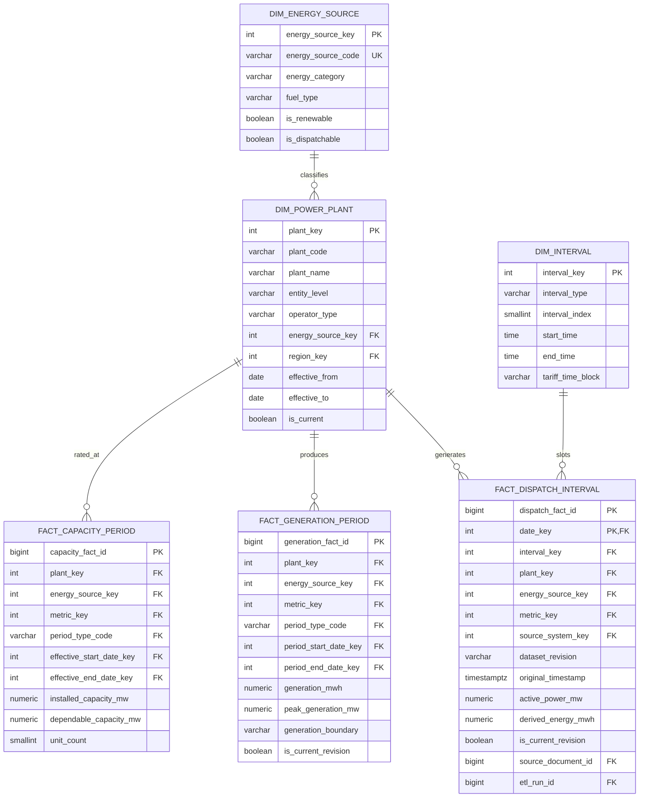
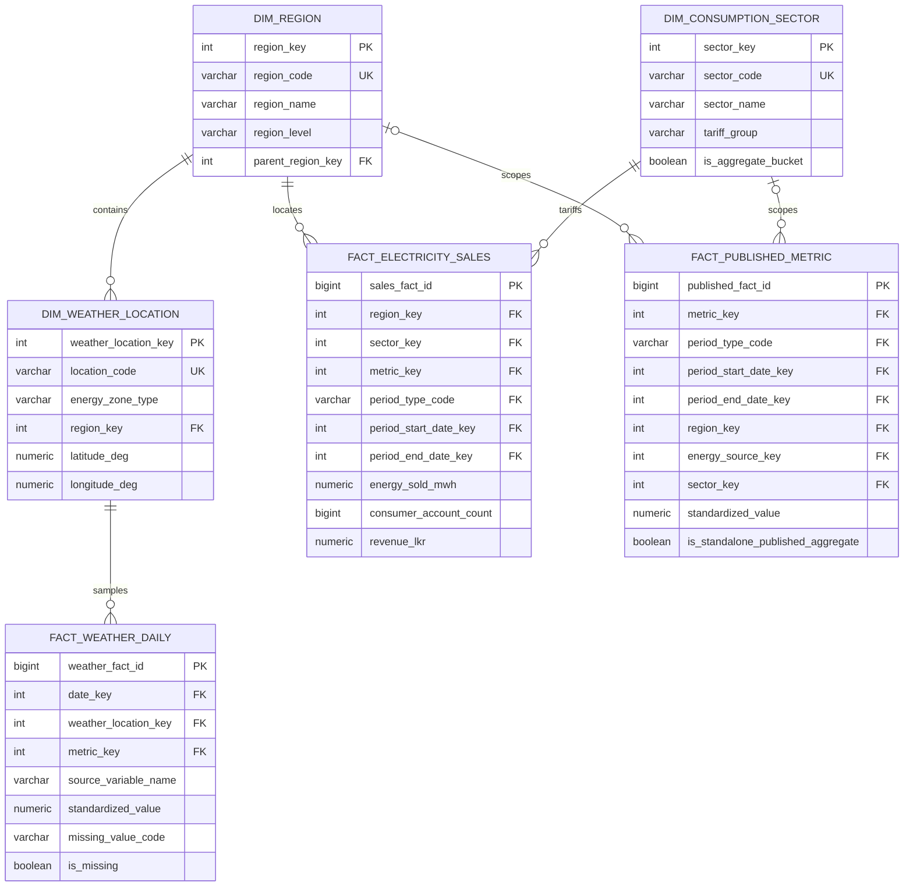
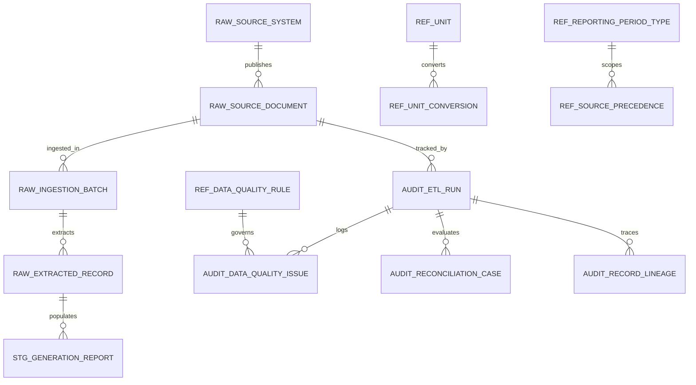

# Fact Constellation & Schema Entity-Relationship Diagrams

## 1. Complete Kimball Fact Constellation Diagram (`dw` Schema)

Implemented in [005_dimensions.sql](file:///c:/Fullstack%20development%20course/Data%20Ware%20House%20Project/database/migrations/005_dimensions.sql)–[008_facts_weather_and_published.sql](file:///c:/Fullstack%20development%20course/Data%20Ware%20House%20Project/database/migrations/008_facts_weather_and_published.sql):

```mermaid
erDiagram
    DIM_DATE ||--o{ FACT_DISPATCH_INTERVAL : "date_key"
    DIM_INTERVAL ||--o{ FACT_DISPATCH_INTERVAL : "interval_key"
    DIM_POWER_PLANT ||--o{ FACT_DISPATCH_INTERVAL : "plant_key"
    DIM_ENERGY_SOURCE ||--o{ FACT_DISPATCH_INTERVAL : "energy_source_key"
    DIM_METRIC ||--o{ FACT_DISPATCH_INTERVAL : "metric_key"
    DIM_SOURCE_SYSTEM ||--o{ FACT_DISPATCH_INTERVAL : "source_system_key"

    DIM_DATE ||--o{ FACT_GENERATION_PERIOD : "period_start_date_key / period_end_date_key"
    DIM_POWER_PLANT ||--o{ FACT_GENERATION_PERIOD : "plant_key"
    DIM_ENERGY_SOURCE ||--o{ FACT_GENERATION_PERIOD : "energy_source_key"
    DIM_METRIC ||--o{ FACT_GENERATION_PERIOD : "metric_key"
    DIM_SOURCE_SYSTEM ||--o{ FACT_GENERATION_PERIOD : "source_system_key"

    DIM_DATE ||--o{ FACT_CAPACITY_PERIOD : "effective_start_date_key / effective_end_date_key"
    DIM_POWER_PLANT ||--o{ FACT_CAPACITY_PERIOD : "plant_key"
    DIM_ENERGY_SOURCE ||--o{ FACT_CAPACITY_PERIOD : "energy_source_key"
    DIM_METRIC ||--o{ FACT_CAPACITY_PERIOD : "metric_key"
    DIM_SOURCE_SYSTEM ||--o{ FACT_CAPACITY_PERIOD : "source_system_key"

    DIM_DATE ||--o{ FACT_ELECTRICITY_SALES : "period_start_date_key / period_end_date_key"
    DIM_REGION ||--o{ FACT_ELECTRICITY_SALES : "region_key"
    DIM_CONSUMPTION_SECTOR ||--o{ FACT_ELECTRICITY_SALES : "sector_key"
    DIM_METRIC ||--o{ FACT_ELECTRICITY_SALES : "metric_key"
    DIM_SOURCE_SYSTEM ||--o{ FACT_ELECTRICITY_SALES : "source_system_key"

    DIM_DATE ||--o{ FACT_WEATHER_DAILY : "date_key"
    DIM_WEATHER_LOCATION ||--o{ FACT_WEATHER_DAILY : "weather_location_key"
    DIM_METRIC ||--o{ FACT_WEATHER_DAILY : "metric_key"
    DIM_SOURCE_SYSTEM ||--o{ FACT_WEATHER_DAILY : "source_system_key"

    DIM_DATE ||--o{ FACT_PUBLISHED_METRIC : "period_start_date_key / period_end_date_key"
    DIM_METRIC ||--o{ FACT_PUBLISHED_METRIC : "metric_key"
    DIM_REGION |o--o{ FACT_PUBLISHED_METRIC : "region_key"
    DIM_ENERGY_SOURCE |o--o{ FACT_PUBLISHED_METRIC : "energy_source_key"
    DIM_CONSUMPTION_SECTOR |o--o{ FACT_PUBLISHED_METRIC : "sector_key"
    DIM_SOURCE_SYSTEM ||--o{ FACT_PUBLISHED_METRIC : "source_system_key"

    DIM_ENERGY_SOURCE ||--o{ DIM_POWER_PLANT : "energy_source_key"
    DIM_REGION |o--o{ DIM_POWER_PLANT : "region_key"
    DIM_REGION ||--o{ DIM_WEATHER_LOCATION : "region_key"
    DIM_REGION |o--o{ DIM_REGION : "parent_region_key"
```

---

## 2. Detailed Sub-Model 1: Generation, Dispatch & Capacity Star Cluster

---

## 3. Detailed Sub-Model 2: Sales, Weather & Published Benchmark Cluster

---

## 4. Detailed Sub-Model 3: Provenance (`raw`), `staging`, `ref`, and `audit` Lineage

