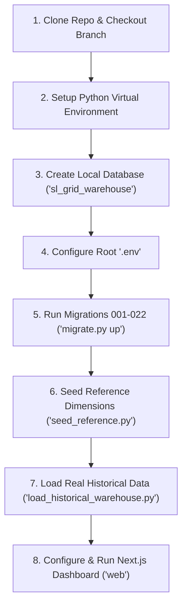

# GridLens — Local Native PostgreSQL Setup & Full Replication Guide
## (No Docker Required — Step-by-Step for Team Members)

**Project:** GridLens — Sri Lanka National Electricity Grid Analytics Data Warehouse  
**Target:** Local Development & Academic Evaluation on Native PostgreSQL (Windows / macOS / Linux)  
**Target Audience:** Team Members & Evaluators using locally installed PostgreSQL (pgAdmin / psql)  
**Repository:** `https://github.com/HajithMohamed/LankaGrid-Analytics`  

---

## 1. System Requirements & Prerequisites

Before starting, ensure your local workstation has the following installed:

1. **Git**: Installed and available in terminal (`git --version`).
2. **Local PostgreSQL**: Any modern version (PostgreSQL 14, 15, 16, 17, or 18) installed locally via the standard EnterpriseDB installer or package manager. Must have `psql` or **pgAdmin** installed and running on `localhost` (default port `5432`).
3. **Python 3.11, 3.12, 3.13, or 3.14**: Installed with pip (`python --version`). Make sure "Add Python to PATH" was selected during installation.
4. **Node.js (v20+ or v22+) & pnpm**:
   - Verify Node.js: `node -v`
   - Install `pnpm` globally if not already installed:
     ```powershell
     npm install -g pnpm
     ```

---

## 2. Complete Step-by-Step Setup from Scratch



---

### Step 1: Clone the Repository

Open PowerShell or Command Prompt:

```powershell
# Clone the repository
git clone https://github.com/HajithMohamed/LankaGrid-Analytics.git

# Move into project directory
cd LankaGrid-Analytics

# Ensure you are on the latest development/feature branch
git checkout development
# (or the working branch: git checkout fix/phase-5-dashboard-accuracy-and-demo)
```

---

### Step 2: Setup Python Virtual Environment

```powershell
# Create a virtual environment named .venv
python -m venv .venv

# Activate the virtual environment
# Windows PowerShell:
.\.venv\Scripts\Activate.ps1
# (If PowerShell blocks script execution, first run: Set-ExecutionPolicy -Scope Process -ExecutionPolicy Bypass)

# Windows Command Prompt:
# .venv\Scripts\activate.bat

# macOS / Linux:
# source .venv/bin/activate

# Upgrade pip and install all project dependencies
python -m pip install --upgrade pip
pip install -e .
pip install pytest pytest-cov ruff mypy
```

---

### Step 3: Create Local PostgreSQL Database

Your local PostgreSQL installation must have the empty database created before running migrations.

#### Option A: Using `psql` (Command Line)
```powershell
# Connect to your local PostgreSQL with your superuser (usually 'postgres')
psql -U postgres -h localhost -p 5432

# Inside the psql prompt, run:
CREATE DATABASE sl_grid_warehouse;
CREATE DATABASE sl_grid_warehouse_test;

# Exit psql:
\q
```

#### Option B: Using pgAdmin GUI
1. Open **pgAdmin**.
2. Connect to your local server (**PostgreSQL 14/15/16/17/18**).
3. Right-click on **Databases** -> **Create** -> **Database...**
4. Enter Database Name: `sl_grid_warehouse` and click **Save**.
5. (Optional for running unit tests): Repeat to create `sl_grid_warehouse_test`.

---

### Step 4: Configure Root `.env` File

Copy the template `.env.example` to `.env` in the root directory:

```powershell
Copy-Item .env.example .env
```

Open `.env` in VS Code or Notepad and configure your local PostgreSQL connection settings:

```ini
# ==============================================================================
# Local Native PostgreSQL Settings
# ==============================================================================
POSTGRES_HOST=localhost
POSTGRES_PORT=5432
POSTGRES_DB=sl_grid_warehouse

# Use your local PostgreSQL superuser to execute initial migrations & role grants:
POSTGRES_USER=postgres
POSTGRES_PASSWORD=your_actual_local_postgres_password

# Passwords to be assigned to application roles (can be kept as defaults):
POSTGRES_ETL_USER=grid_etl
POSTGRES_ETL_PASSWORD=grid_etl_dev_password_change_me
POSTGRES_ANALYST_USER=grid_analyst
POSTGRES_ANALYST_PASSWORD=grid_analyst_dev_password_change_me
POSTGRES_SSLMODE=disable

# Separate Test Database
POSTGRES_TEST_DB=sl_grid_warehouse_test
```

> [!NOTE]
> If your local PostgreSQL runs on a port other than `5432` (e.g. `5433`), update `POSTGRES_PORT` accordingly.

---

### Step 5: Run Database Migrations (001–022) & Configure Roles

The warehouse uses 22 sequential forward SQL migrations to build the Kimball schemas (`dw`, `staging`, `audit`, `mart`, `ref`, `raw`):

```powershell
# 1. Inspect migration status (shows 22 PENDING migrations)
python scripts/migrate.py status

# 2. Execute all 22 migrations in order
python scripts/migrate.py up

# 3. Configure least-privilege role passwords (grid_etl and grid_analyst)
python scripts/migrate.py configure-roles
```

*Expected output: All 22 migrations applied successfully up to `022_dashboard_readonly_role_and_security`.*

---

### Step 6: Seed Reference Taxonomies & Conformed Dimensions

This populates calendar dates (2020–2024), 96 daily 15-minute TOU intervals, official power plant entities, and fuel categories:

```powershell
python scripts/seed_reference.py
```

*Expected output: Seeds `dw.dim_date` (1,827 rows), `dw.dim_interval` (96 rows), `dw.dim_power_plant` (54 plants), `dw.dim_energy_source` (9 categories), `dw.dim_consumption_sector` (10 sectors), etc.*

---

### Step 7: Load Real Historical Grid Data into the Warehouse

This runs the automated ETL pipeline to parse and load official CEB, NASA POWER, and PUCSL raw files:

```powershell
python scripts/load_historical_warehouse.py
```

This populates the warehouse fact tables with verified data:
1. **CEB 5-Year Billed Electricity Sales (2020–2024)** -> `dw.fact_electricity_sales` (49 rows)
2. **NASA POWER 5-Year Meteorological Observations (2020–2024)** -> `dw.fact_weather_daily` (21,924 rows)
3. **PUCSL Sub-Daily 15-Minute Dispatch Curves (March 2024, all 31 days)** -> `dw.fact_dispatch_interval_y2024` (107,115 rows)
4. **Dead-Letter Quarantine Log** -> `audit.data_quality_issue` (926 quarantined anomalies safely isolated)

---

### Step 8: Verify Database Integrity & Run Tests

Verify that your local database matches the official warehouse standards:

```powershell
# 1. Run database structural and row-count verification
python scripts/verify_database.py

# 2. Run automated test suite (all 47 tests should pass)
pytest tests/unit tests/data_quality -v
```

---

### Step 9: Configure and Run the Next.js Analytics Dashboard

Now that your local PostgreSQL is populated with data, run the frontend web dashboard:

```powershell
# 1. Move into the web directory
cd web

# 2. Create web/.env.local from web/.env.example
Copy-Item .env.example .env.local
```

Edit `web/.env.local` to point to your local database:

```ini
POSTGRES_HOST=localhost
POSTGRES_PORT=5432
POSTGRES_DB=sl_grid_warehouse

# Connect with the read-only analyst role configured in Step 5:
POSTGRES_USER=grid_analyst
POSTGRES_PASSWORD=grid_analyst_dev_password_change_me

# (Alternatively, you can connect using POSTGRES_USER=postgres and your postgres password)

DATA_SOURCE_MODE=hybrid
QUERY_STATEMENT_TIMEOUT_MS=5000
MAX_QUERY_ROWS_LIMIT=5000
NODE_ENV=development
```

Install frontend packages and start the application:

```powershell
# 3. Clean any existing cache
Remove-Item -Recurse -Force .next -ErrorAction SilentlyContinue

# 4. Install dependencies
pnpm install

# 5. Start development server
pnpm run dev
```

Open your browser to:
👉 **http://localhost:3000**

You will see:
- Top navigation with **"PostgreSQL 18 Connected"** (green indicator).
- Executive Overview with dynamic year filtering (2020–2024), 14,287 to 15,190 GWh billed sales, and March 2024 generation mix.
- All 8 analytical pages fully styled with Premium White theme.
- Query Explorer showing live PostgreSQL execution times and OLAP method explanations.

---

## 3. Summary of Common Commands for Daily Development

| Task | Command |
| :--- | :--- |
| **Check migration status** | `python scripts/migrate.py status` |
| **Apply new migrations** | `python scripts/migrate.py up` |
| **Reload historical data** | `python scripts/load_historical_warehouse.py` |
| **Run unit & quality tests** | `pytest tests/unit tests/data_quality -v` |
| **Check code formatting** | `ruff check .` and `ruff format --check .` |
| **Start Next.js dashboard** | `cd web; pnpm run dev` |
| **Build Next.js for production** | `cd web; pnpm run build; pnpm start` |

---

## 4. Troubleshooting Common Issues

### Issue 1: `FATAL: password authentication failed for user "postgres"`
* **Cause**: The password in `.env` does not match the password you set when installing PostgreSQL.
* **Fix**: Open `.env` and verify `POSTGRES_PASSWORD=<your_actual_password>`. Test by running `psql -U postgres -h localhost -p 5432`.

### Issue 2: `connection to server at "localhost", port 5432 failed: Connection refused`
* **Cause**: The PostgreSQL Windows Service is not running.
* **Fix**: Press `Win + R`, type `services.msc`, locate `postgresql-x64-XX` (or your version), right-click and click **Start**.

### Issue 3: `role "grid_analyst" does not exist`
* **Cause**: Step 5 was skipped or only partially executed.
* **Fix**: Run `python scripts/migrate.py up` followed by `python scripts/migrate.py configure-roles`.

### Issue 4: Next.js shows `Historical Snapshot Active` instead of `PostgreSQL 18 Connected`
* **Cause**: The credentials in `web/.env.local` cannot connect to your local database.
* **Fix**: Verify `web/.env.local` contains the same `POSTGRES_PORT` and matching credentials. You can set `POSTGRES_USER=postgres` and your superuser password in `web/.env.local` for instant local access.

### Issue 5: `Execution of script is disabled on this system` (PowerShell)
* **Cause**: Windows PowerShell execution policy restricts running scripts.
* **Fix**: Run `Set-ExecutionPolicy -Scope Process -ExecutionPolicy Bypass` in your PowerShell window before activating `.venv`.
